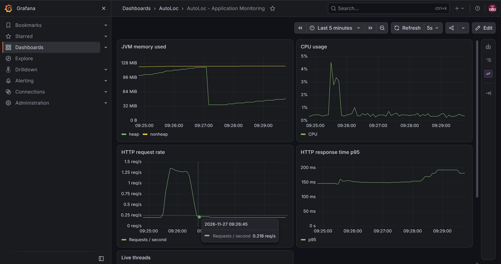

# AutoLoc

> Rendu Architecture des systèmes d'information et performance -- Kinsey WITKOWSKI & Kamelia CHEMALA

AutoLoc is a Spring Boot backend project for car rentals. It models agencies, customers, vehicles, reservations, contracts and payments.

## Features

- MySQL persistence with JPA relationships.
- API authentication and USER/ADMIN access rules.
- Application monitoring with Prometheus and Grafana.

## Technologies

Java 17+, Spring Boot, Spring Data JPA, Spring Security, MySQL and Docker.

## Getting started

Follow the [installation instructions](docs/installation.md) to run the API and monitoring services.

## Documentation

- [Conceptual model](docs/conceptual-model.md)
- [Fetch and cascade choices](docs/fetch-strategy.md)
- [Security](docs/security-notes.md)
- [Monitoring](docs/monitoring-notes.md)
