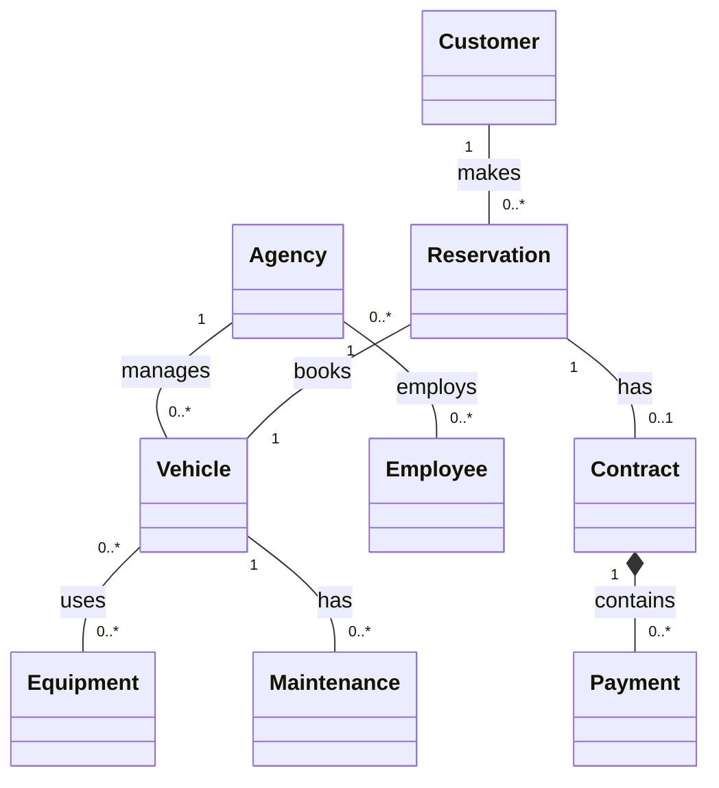

# Section 12: AutoLoc conceptual model and English reference

Section 12 supplies English names for reading the conceptual model. The Java
project retains its French identifiers and existing database tables. Renaming
the entities is not necessary to implement this reference and would require
updating mappings, tests, queries and a database migration.

## Names and attributes

Each row lists corresponding attributes in the same order. Relationship fields
are shown in the diagram below rather than included in these scalar attributes.

| English class | Java class / database table | English attributes | Current Java attributes |
| --- | --- | --- | --- |
| Agency | `Agence` / `agence` | agencyId, name, city, address, phone | idAgence, nom, ville, adresse, telephone |
| Employee | `Employe` / `employe` | employeeId, lastName, firstName, role | idEmploye, nom, prenom, role |
| Vehicle | `Vehicule` / `vehicule` | vehicleId, registrationNumber, brand, model, category, dailyRate, status | idVehicule, immatriculation, marque, modele, categorie, tarifJournalier, statut |
| Equipment | `Equipement` / `equipement` | equipmentId, label | idEquipement, libelle |
| Customer | `Client` / `client` | customerId, lastName, firstName, email, phone, licenceNumber, registrationDate | idClient, nom, prenom, email, telephone, numPermis, dateInscription |
| Reservation | `Reservation` / `reservation` | reservationId, startDate, endDate, status | idReservation, dateDebut, dateFin, statut |
| Contract | `Contrat` / `contrat` | contractId, signatureDate, totalAmount, valid | idContrat, dateSignature, montantTotal, valide |
| Payment | `Paiement` / `paiement` | paymentId, amount, paymentDate, paymentMethod | idPaiement, montant, datePaiement, modePaiement |
| Maintenance | `Maintenance` / `maintenance` | maintenanceId, startDate, endDate, description | idMaintenance, dateDebut, dateFin, description |

`EmployeeRole` corresponds to `RoleEmploye` (`AGENT`, `MANAGER`). Other enum
types remain `CategorieVehicule`, `StatutVehicule`, `StatutReservation` and
`ModePaiement`. Entity identifiers use `Long`, dates use `LocalDate`, and amounts
use `BigDecimal` mapped to `DECIMAL(10,2)`.

## UML relationships



Read the multiplicity beside a class as the number of its instances allowed
for one instance at the opposite end. For example, a vehicle can have many
reservations, while each reservation is conceptually for one vehicle. A
reservation may have no contract yet, or one contract. The unique reservation
foreign key in `contrat` prevents multiple contracts for the same reservation.

The filled diamond marks composition: payments belong to their contract's
lifecycle. Shared equipment is an ordinary many-to-many association, so deleting
a vehicle must not delete equipment that other vehicles still use.

The diagram represents the assignment's conceptual multiplicities. Database
foreign keys are currently nullable to accommodate existing rows and the guided
exercise's standalone contracts. Thus the database can temporarily contain
unassigned entities. Enforcing every mandatory parent at database level would
require backfilling those rows and migrating the relevant columns to `NOT NULL`.
This exercise does not perform that data migration.

## Composition in JPA

The existing `Contrat.paiements` mapping now includes all section 12 requirements:

```java
@OneToMany(
    mappedBy = "contrat",
    cascade = CascadeType.ALL,
    orphanRemoval = true,
    fetch = FetchType.LAZY
)
private List<Paiement> paiements = new ArrayList<>();
```

- `mappedBy` reuses the owning `Paiement.contrat` association and its foreign key.
- `ALL` propagates persistence operations, including deletion, from contract to payments.
- `orphanRemoval` deletes a persisted payment removed from a managed contract's collection.
- `LAZY` defers loading the collection until it is accessed inside the transaction.

Use the helpers in application code within a transaction:

```java
contrat.addPaiement(paiement);
contrat.removePaiement(paiement);
```

Removing a managed contract deletes its payments through cascade REMOVE.
Removing just one payment through the helper deletes only that payment at flush;
the contract and its other payments remain. This does not require changing the
database schema: Hibernate performs the DELETE, rather than relying on a database
ON DELETE CASCADE constraint. A payment attached to another contract is rejected
by `addPaiement`; it is not silently moved between composition parents.

All other associations and lifecycle choices are documented in
[fetch-strategy.md](fetch-strategy.md).

## Verification

`AssociationMappingTests` includes a database test that persists a contract and
two payments, reloads them, removes one payment using the helper, flushes and
reloads again. It asserts that the removed payment is deleted, while the contract
and the other payment still exist. A separate test checks that attaching a
payment already belonging to another contract is rejected without changing either
collection. Test transactions roll back their sample rows.

All nine tests passed against local MySQL after adding orphan removal. Production
and test sources compiled with Lombok and a Java 17 target; the tests ran through
the JUnit Platform launcher using the installed dependencies. This includes the
existing association, fetch and application-context checks.
