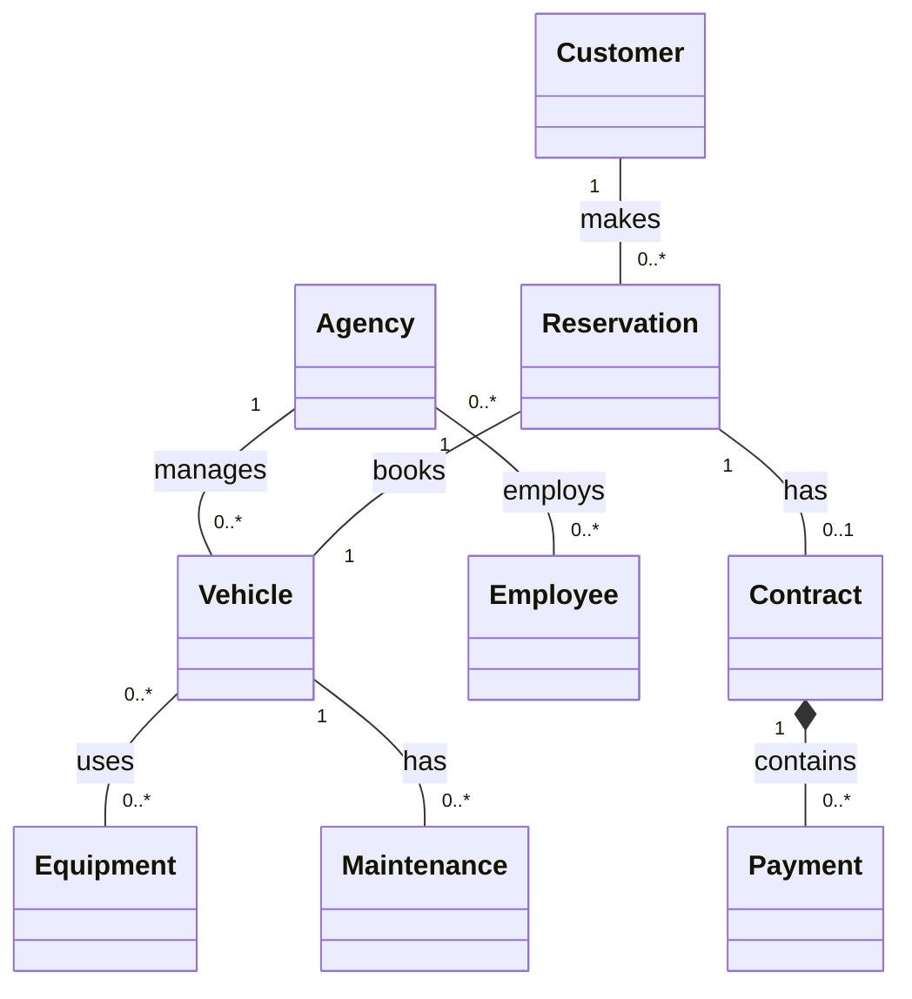

# AutoLoc conceptual model

English names are a reading guide. Java classes and database tables keep their French names.

## Name mapping

Attributes correspond in the order shown.

| English class | Java class | English attributes | Java attributes |
| --- | --- | --- | --- |
| Agency | `Agence` | agencyId, name, city, address, phone | idAgence, nom, ville, adresse, telephone |
| Employee | `Employe` | employeeId, lastName, firstName, role | idEmploye, nom, prenom, role |
| Vehicle | `Vehicule` | vehicleId, registrationNumber, brand, model, category, dailyRate, status | idVehicule, immatriculation, marque, modele, categorie, tarifJournalier, statut |
| Equipment | `Equipement` | equipmentId, label | idEquipement, libelle |
| Customer | `Client` | customerId, lastName, firstName, email, phone, licenceNumber, registrationDate | idClient, nom, prenom, email, telephone, numPermis, dateInscription |
| Reservation | `Reservation` | reservationId, startDate, endDate, status | idReservation, dateDebut, dateFin, statut |
| Contract | `Contrat` | contractId, signatureDate, totalAmount, valid | idContrat, dateSignature, montantTotal, valide |
| Payment | `Paiement` | paymentId, amount, paymentDate, paymentMethod | idPaiement, montant, datePaiement, modePaiement |
| Maintenance | `Maintenance` | maintenanceId, startDate, endDate, description | idMaintenance, dateDebut, dateFin, description |

`EmployeeRole` maps to `RoleEmploye` (`AGENT`, `MANAGER`). IDs use `Long`, dates use `LocalDate`, and amounts use `BigDecimal` / `DECIMAL(10,2)`.

## Relationships

`0..*` means zero or more; `0..1` means optional and unique. The diamond marks composition: payments depend on their contract.

The diagram shows conceptual requirements. Database foreign keys remain nullable for existing rows and standalone exercise contracts. Enforcing mandatory parents would require a data migration.

## Contract and payment lifecycle

`Contrat.paiements` uses `mappedBy = "contrat"`, `ALL`, `orphanRemoval = true`, and `LAZY`.

- Delete a contract: its payments are deleted too.
- Call `contrat.removePaiement(paiement)` on managed entities: only that payment is deleted at flush.
- Call `contrat.addPaiement(paiement)` to link both sides. Moving a payment from another contract is rejected.

See [fetch-strategy.md](fetch-strategy.md) for all mapping choices. Database tests confirm orphan removal preserves the contract and its remaining payments.
